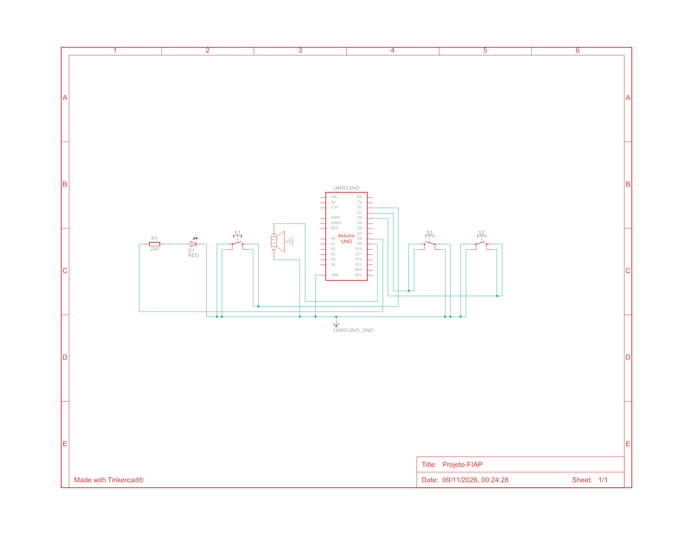

# Sistema Integrado de Futuro Sustentável em Marte (SIFSM)

Repositório oficial do projeto desenvolvido para a Fase 7, focado no gerenciamento e na simulação computacional de infraestrutura autossustentável para colônias marcianas (Módulo Aurora Siger).

## 🚀 Tecnologias Utilizadas
* Python (Simulações e Integração com Banco de Dados)
* Oracle Database (Persistência e Estruturação SQL)
* Git & GitHub (Controle de Versão)
## Alerta energético integrado ao Circuit Design

Execute `python codigo_fonte.py` e selecione **10**. A opção funciona sem Oracle
ou bibliotecas externas e permite leitura manual, análise do CSV existente e
exportação da tabela verdade para `data/circuito/`.

A regra é `Alerta = (A e B) ou C`: A indica consumo maior ou igual ao limite;
B indica módulo crítico; C indica falha. Informe leitura e limite na mesma
unidade. O CSV original não informa B/C: os estados fornecidos pelo operador
são aplicados a todas as linhas. Os limites são didáticos e configuráveis.

### Arduino / Tinkercad

Abra o circuito existente e copie o conteúdo de
`simulador/alerta_energetico/alerta_energetico.ino` para o editor de código Texto.
Botões A/B/C: D2/D3/D4 ligados a GND com INPUT_PULLUP. LED: D8 com resistor de
220 ohms em série para GND. Piezo: positivo D9, negativo GND.

Inicie a simulação. No Monitor Serial (9600 baud), envie `SET 110` seguido de
Enter para reproduzir A=1, B=1, C=0. Use a coluna `comando_serial` do CSV para
reproduzir cada leitura. `BTN` devolve o controle aos botões. O LED e o piezo
seguem o alerta. A transferência Python → Tinkercad é manual por comandos;
não há conexão automática em tempo real.

Tabela esperada, em ordem 000 a 111: **0, 1, 0, 1, 0, 1, 1, 1**.

Validação Python: `python -m unittest discover -s tests -v`.
O novo sketch ainda precisa ser compilado e validado no simulador.

## Arquivos do circuito e validação

- [Esquema original em PDF](docs/circuito/Projeto-FIAP.pdf)
- [Lista de componentes exportada](docs/circuito/lista-componentes.csv)
- [Guia da montagem e roteiro de testes](docs/circuito/README.md)
- [Tabela verdade e comandos para o simulador](docs/circuito/tabela-verdade.csv)
- [Resultado dos testes Python](docs/circuito/resultado-testes-python.txt)

O PDF e a lista de componentes são exportações fornecidas pelo autor.
A imagem acima foi renderizada a partir desse PDF. O código Arduino está em
[simulador/alerta_energetico](simulador/alerta_energetico/alerta_energetico.ino).
